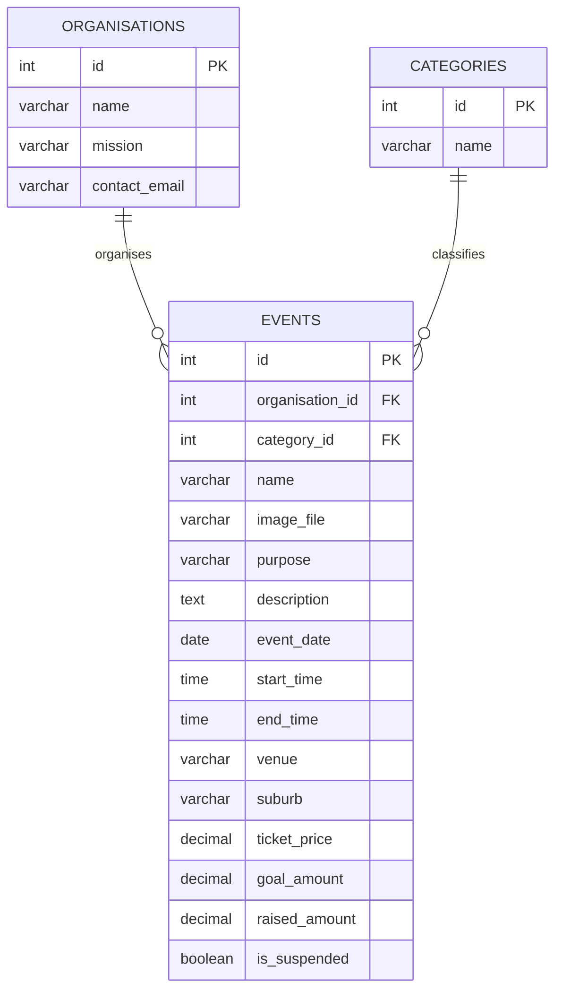

# Report teaching example

`report/PROG2002 A2 Report.docx` is a completed instructor example. It follows the supplied headings, uses Arial 12 pt with 1.5 line spacing, and leaves Student ID, Last Name and First Name blank. The three-page report explains the current website and includes a data relationship diagram and API table.

The example is grounded in these project files:

| Template section | Evidence to inspect and explain |
| --- | --- |
| Introduction / Motivation | The organisation's purpose on the home and About pages; the event types and causes represented in the SQL data. |
| Problem Statement | Visitors need to compare events by date, place, ticket price and cause. Past and suspended events must stay out of public results. |
| Solution | Follow one `fetch` from a page script to an Express route, a MySQL query, its JSON response and the DOM update. Register currently displays only the specified alert. |
| Web UX | The four-page navigation, date/location/category filters, Clear Filters button, empty and error messages, event details, mobile layout and keyboard focus. |
| Data Schema | In `api/charityevents_db.sql`, identify each table's primary key, the two foreign keys in `events`, and the event fields used by the pages, including `image_file`. |
| API design | Explain the three GET routes in `api/server.js`. Search uses optional query parameters; these GET requests have no request body. POST, PUT and DELETE are outside A2. |

The project title is filled in. The GenAI declaration describes the instructor example; it is not a declaration for another author. The diagram and API descriptions should be checked again if the implementation changes.

## Relationship diagram for study

