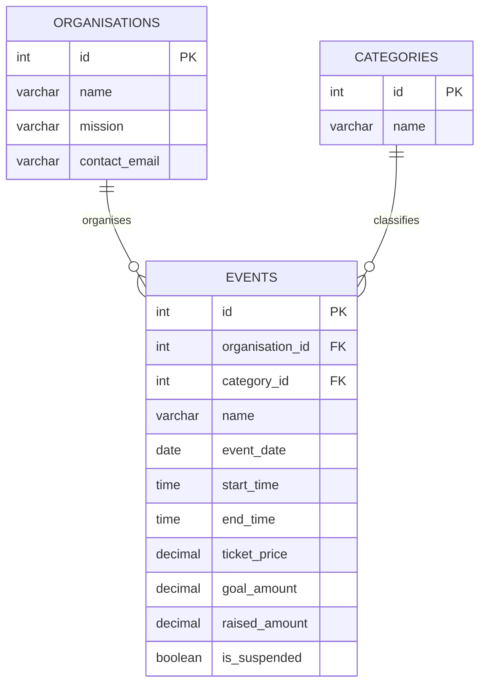

# Report preparation guide

The file in `report/` preserves the supplied assessment template and has been formatted to Arial 12 pt with 1.5 line spacing. It is intentionally unfilled so the student can write the final report in their own words, as required by the assessment's GenAI rules.

Use this guide to inspect the working project before answering each template prompt:

| Template section | Evidence to inspect and explain |
| --- | --- |
| Introduction / Motivation | The Sydney Community Giving scenario, the organisation message on the home page, and why local events can connect supporters with causes. |
| Problem Statement | The need for a public way to discover relevant events and view the key details in one place. |
| Solution | The path from browser `fetch` to Express GET route, MySQL query, JSON response and DOM update. Mention that registration is deliberately an under-construction alert for A2. |
| Web UX | Navigation on all three pages, filter controls, clear button, event cards, loading/empty/error messages, mobile layout and keyboard focus. |
| Data Schema | The `organisations`, `categories` and `events` tables in `api/charityevents_db.sql`; identify the primary keys and the two foreign keys in `events`. |
| API design | `GET /api/events`, `GET /api/categories`, `GET /api/events/:id`. For the search endpoint, describe optional query parameters and JSON results. GET requests have no request body here; POST/PUT/DELETE are outside A2. |

Add the student's own project title, ID and name. Check that any diagrams and screenshots match the final code. The assignment requires a GenAI-use declaration based on actual use.

## Relationship diagram for study

